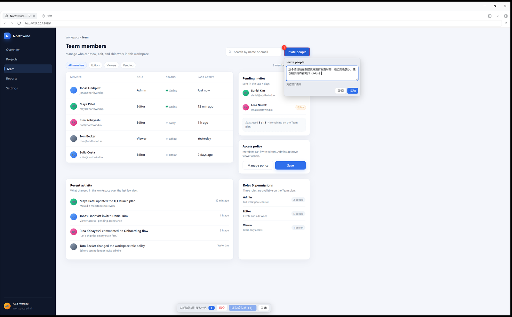
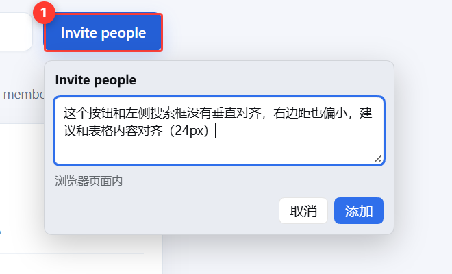

# Viewport Annotate

**Box the problem on a full screenshot, then drop the screenshot and numbered comments into the composer.**

`DeepSeek Harness 0.2.2` · `Desktop-first` · `MIT`

[中文](README.md) | English



## Why a full viewport instead of a crop

A cropped screenshot loses its context: the model cannot tell that the button sits in the top-right of a card, or that a heading belongs above it. This plugin keeps the **whole viewport** as the base image and uses red boxes with numbers to point at the places you are talking about. The model sees the complete page plus “box 1 is this, box 2 is that”.

## Features

- **One screenshot per viewport state.** Scrolling and annotating again produces a second image instead of losing the first one.
- **Red boxes baked into the PNG.** Red stroke, white halo and a numbered badge; nothing is painted over the live page.
- **Numbers match the comments.** One insert can contain several screenshots; the caption groups comments by screenshot.
- **Inserts, does not send.** Screenshots become image drafts, comments are appended to the composer, and your existing draft text is kept. Edit, then send yourself.
- **Works in a fullscreen Browser panel.** A floating “Annotate” pill stays clickable even when the page covers the whole window.
- **Chinese and English**, following the Harness locale and switching live.



## Supported surfaces

| Surface | Capture | Notes |
| --- | --- | --- |
| Pages in the Browser panel | guest script + `capturePage()` | full viewport, real pixels |
| Document Preview: Markdown / code / plain text | window DOM snapshot | text, layout, boxes |
| Document Preview: images / PDF / Office-as-PDF / spreadsheets | window DOM snapshot | images and canvases are embedded before compositing |
| Harness UI (chat, tool cards, plugin pages) | window DOM snapshot | — |
| Document Preview: HTML | not supported | sandboxed iframe; switch the preview to plain text/code |

The host snapshot first paints loaded images into a canvas and embeds them, so blob URLs, authenticated file routes and custom schemes survive. Images the browser genuinely cannot read (cross-origin without CORS, expired blobs) are skipped and counted in the caption.

## Usage

1. Open the Browser panel, or a file in Document Preview, or stay on the Harness UI.
2. Click the annotate icon next to the composer, or the floating **Annotate** pill.
3. Click an element or drag a region, write a comment, press **Add** (Ctrl/Cmd+Enter).
4. Scroll and annotate more if needed, then press **Insert into input**.

The insert targets **the chat currently open in the main view**, not the session that happens to own the Browser pane. Hover the insert button to see the target title.

## Install

Install the bundled `dsh` command from **Settings → Account → Manage dsh Command…**, then fully quit Desktop:

```sh
dsh plugin --profile desktop add "link:C:\path\to\annotate-viewport"
```

Reopen Desktop and enable `dsh-annotate-viewport` on the Plugins page. The repo ships the built `client.js`; installing does not require a build.

## Limits

- The screenshot is the **current viewport**, not the full document. Annotate long pages screen by screen.
- The Web profile's Browser is a cross-origin iframe; full screenshots only work with Desktop's `<webview>`.
- HTML previews are sandboxed iframes and cannot be captured; switch to plain text/code.
- Screenshots are sent to the model as attachments; do not box passwords or tokens.

## Capacity

- Harness defaults to **20 images per message**; the plugin creates one image per viewport state and blocks inserts beyond that limit.
- A single screenshot with 1000 annotations still renders (about 135 ms, ~610 KB), but model readability fails first: keep it to **≤30 annotations per screenshot, ≤5 screenshots (≤150) per insert**.
- See the [capacity report](docs/stress-report.md) for the full sweep.

## Implementation

| Capability | API |
| --- | --- |
| Composer entry | `conversation.input.left` |
| Window overlay | `shell.overlay` + `createPortal(document.body)` |
| Draft insertion | `conversation.createDrafts()` → `shell.addAttachments()` → `shell.setDraft()` |
| Browser selection | `webview.executeJavaScript()` |
| Browser capture | `webview.capturePage()` + Canvas compositing |

These are client-internal Harness APIs, verified against 0.2.2-rc.1.

## Development

```sh
npm ci
npm run build
npm test
npm run test:harness   # headless Edge; requires ../test-tools react/react-dom
npm run test:bench
```

## Relationship to upstream

A fork of [DSH-AnnotateAnything](https://github.com/Meatware-Engineering/DSH-AnnotateAnything) (MIT). It keeps the window snapshot, guest injection and pointer picker; this fork switches to full-viewport bases with numbered red boxes, inserts drafts instead of sending, adds the fullscreen entry, target-session resolution, bilingual UI and regression tests.

MIT. Original implementation © 2026 Meatware Engineering; modifications © 2026 annotate-viewport contributors.
