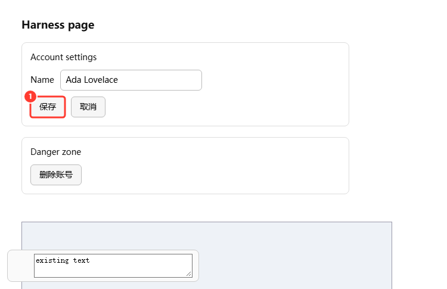
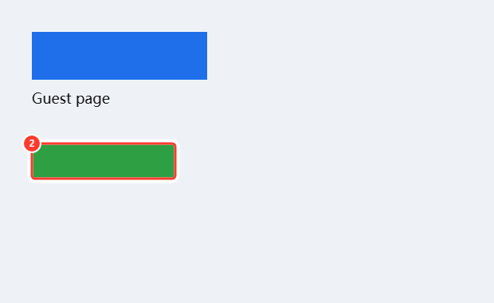

# dsh-annotate-viewport

给 DeepSeek Harness 的**整屏标注**插件：每个视口截一张完整截图，用带编号的红色框标出要评论的位置，最后把截图（红框已烘焙进 PNG）和评论一起插入当前会话的输入框草稿。

这是 [DSH-AnnotateAnything](https://github.com/Meatware-Engineering/DSH-AnnotateAnything) 的 fork（MIT）。上游是"只截选中区域"，本 fork 改成"整屏底图 + 红框"，因为裁剪掉上下文后，模型很容易理解偏。





上面两张图是 `test/harness` 在真实 Chromium 里跑出来的产物：整屏截图 + 红框 + 全局编号，编号与插入输入框的文字编号一致。

## 和上游的区别

| | 上游 | 本插件 |
|---|---|---|
| 截图 | 每条标注裁一小块 | 每个视口状态一张完整截图 |
| 标注 | 图里没有框，靠文字描述坐标 | 红框 + 编号直接画进 PNG |
| 编号 | 按裁图顺序 | 全局编号，跨多张截图连续 |
| 输出 | 直接 `sendSession` 发送 | 插入输入框草稿，可继续编辑、自己按发送 |
| 语言 | 英/俄 | 中/英 |

## 行为

1. 点输入框左侧的**标注**按钮，或窗口**右下角的「标注」胶囊**进入标注模式（浏览器面板全屏时也能用）。
2. 点击页面元素，或按住拖出一个区域；每处会生成一条标注。
3. 在卡片里写评论，点**添加**。
4. 滚动页面再标注时，会为新的视口状态再截一张图；每条标注归属于它被创建时的那张截图。
5. 点**插入输入框**：每张截图生成一个 PNG 附件，评论按编号写成一段文字，追加到当前草稿；已有草稿文字保留。

插入目标是**主界面当前打开的会话**，不是 Browser 面板碰巧所属的会话——Browser 标签可能在别的、保活中的会话里；把鼠标停在「插入输入框」上会显示实际目标会话标题。UI 操作按钮用蓝色，截图里的红框/编号用红色；按钮悬停时保持蓝底白字。

标注层通过 `ReactDOM.createPortal` 挂到 `document.body`，因此层级高于右侧 Sidebar 的全屏面板；截图里的红框是最终 PNG 的一部分，不是 UI 控件；编号与文字里的编号一一对应。

## 安装（Desktop）

前置：通过 **设置 → 账号 → Manage dsh Command…** 安装 Desktop 自带的 `dsh` 命令。npm 全局安装的 `dsh` 不能管理 Desktop profile。

```sh
# 1. 先完全退出 Desktop（关窗口不算）
# 2. 把本目录作为链接安装进 desktop profile
dsh plugin --profile desktop add "link:C:\Users\YuanBo\Documents\deepseek-harness\default-workspace\annotate-viewport"
# 3. 重新打开 Desktop，到「插件」页确认 dsh-annotate-viewport 已启用
```

本地开发时，改完源码后：

```sh
npm ci          # 只需一次
npm run build   # 产出 client.js
```

然后重启 Desktop（或等 HMR 重载，取决于 profile 的 HMR 设置）。

> 安装第三方插件等于在 profile 里运行完整权限的客户端代码。装之前请自己读一遍 `src/`；不要在不信任的会话里截取包含密钥的页面。

## 使用范围与限制

- **Desktop 的 Browser 面板**：可用。插件会找到面板里的 Electron `<webview>`，把选择脚本注入 guest 页面，再用 `webview.capturePage()` 拿真实像素。要求该 webview 暴露 `executeJavaScript` 和 `capturePage`。
- **Harness 自己的界面**（会话、工具卡片、设置页）：可用。整窗 DOM 快照 + html-to-image 重建；`canvas`、视频、跨域图片、特殊 CSS 可能失真。
- **Web profile 里的 Browser 标签**：不可用。跨域 iframe 读不到 DOM 也拿不到像素；这是安全边界，不是插件缺陷。
- 截图是**当前视口**，不是整篇文档。滚动后标注会生成第二张截图；超长页面建议按屏标注。
- 一条标注不能同时跨 Harness 界面和 Browser 页面；请在各自表面内选择。
- 页面滚动/跳转/缩放期间截图会失败并提示重选，避免把框画到错误内容上。
- 每张图最长边压到 1600px；视口超过 900 万 CSS 像素直接拒绝。
- 截图会连同页面内容发给模型，注意隐私。

## 实现要点（DSH 0.2.2-rc.1 验证）

- `conversation.input.left`：输入框左侧的触发按钮。
- `shell.overlay`：全窗口标注层。
- `ctx.conversation.createDrafts(sessionId, files, uploadImages)`：把 PNG 变成图片草稿。
- `shell.addAttachments(ids)` + `shell.setDraft(text)`：附件与评论进入输入框。
- Browser 面板：`webview.executeJavaScript()` 注入选择脚本；`webview.capturePage()` 取整屏；guest 通过 `console.log('__DSH_ANNOTATE__' + json)` 回传选择结果。

这些是客户端内部 API，DSH 升级后可能变化；插件在 0.2.2-rc.1 上做了端到端验证。

## 测试

```sh
npm run build
npm test          # 单元测试：几何、选择器、提示词格式、guest 脚本
# 可选：用本机 Edge 无头跑真实 DOM 冒烟
npm install --prefix ../test-tools --no-save react@18.3.1 react-dom@18.3.1
npm run test:harness
```

`test:harness` 会启动无头 Edge，加载构建后的 `client.js`，用 mock 的 Harness ctx 跑通两条路径（Harness 界面 + 模拟 Browser guest），并解码生成的 PNG 检查红框像素。它需要本机安装 Edge；可用 `EDGE` 环境变量覆盖路径。

## 目录

- `src/client.cjs`：Overlay、状态（bases/items）、插入输入框。
- `src/capture.cjs`：整窗 DOM 快照、guest 整屏截图、红框合成。
- `src/guest.cjs`：注入 Browser guest 的选择脚本。
- `src/region.cjs`：指针选择几何（host 与 guest 共用）。
- `src/lib.cjs`：元素描述、选择器、caption 文本。
- `build.mjs`：esbuild 打包成 `window.__ModuleLoader__` 可加载的 `client.js`。

## 许可与归属

MIT。原始实现 © 2026 Meatware Engineering（DSH-AnnotateAnything）；本 fork 的修改 © 2026 annotate-viewport contributors。`client.js` 内含 html-to-image（MIT，见 `THIRD_PARTY_NOTICES.md`）。
